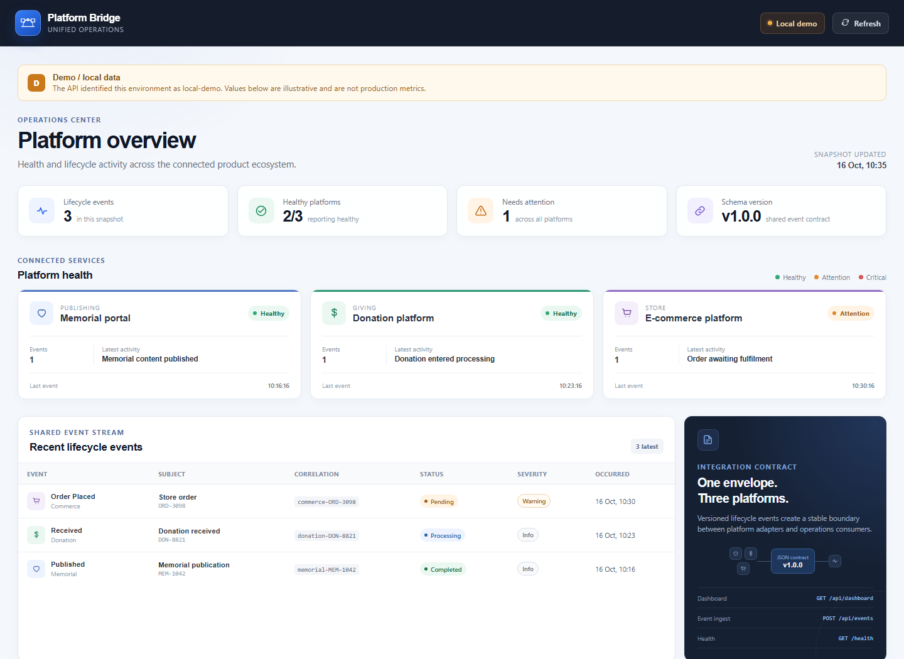
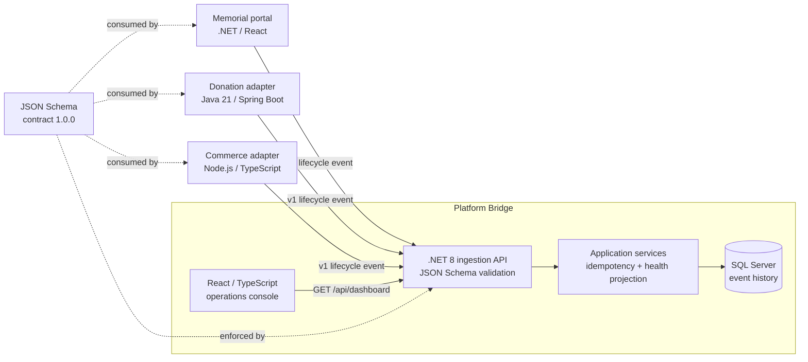

# Platform Bridge

**A compact polyglot operations console for three independently owned platforms.**

[](https://github.com/sherrykisilu/platform-bridge/actions/workflows/ci.yml)
[](https://dotnet.microsoft.com/)
[](https://react.dev/)
[](contracts/platform-lifecycle-event.v1.schema.json)

Platform Bridge is a portfolio proof for operating a mixed estate rather than replacing it. A .NET 8 core receives one versioned lifecycle event from memorial, donation, and commerce adapters, rejects incompatible payloads, stores accepted activity, and gives an operator one clear React dashboard.

The repository intentionally delivers one complete vertical slice: **shared contract -> polyglot adapter -> validated ingestion -> operational read model -> polished UI**.



## Architecture



### Repository map

| Path | Responsibility |
|---|---|
| `contracts/` | Versioned JSON Schema and executable example events |
| `src/core/PlatformBridge.Domain` | Contract-shaped domain records |
| `src/core/PlatformBridge.Application` | Ingestion, idempotency, and dashboard projection |
| `src/core/PlatformBridge.Infrastructure` | EF Core repository with SQL Server and in-memory providers |
| `src/core/PlatformBridge.Api` | Minimal API, schema validation, health, OpenAPI |
| `src/web` | Recruiter-readable React operations console |
| `services/commerce-adapter` | Node.js/TypeScript commerce boundary |
| `services/donation-adapter` | Java donation boundary |
| `infra/` | Minimal Azure Container Apps Bicep |
| `docs/adr/` | Architectural decisions and explicit trade-offs |

## What the console demonstrates

- One operator view across three different technology stacks.
- Contract enforcement before data enters the core.
- Idempotent event ingestion by `eventId`.
- Source/event semantic validation, so a donation adapter cannot emit a commerce event.
- A health projection based on the latest real event severity, not invented production telemetry.
- SQL Server persistence in Docker and a fast in-memory provider for tests/local API work.
- Independent adapter tests plus compatibility tests against the shared schema.
- A realistic Azure deployment shape that can be statically validated without provisioning paid resources.

All dashboard values are labeled **local demo data**. This project makes no claim about production traffic, reliability, donation volume, or commercial performance.

## Run with Docker Compose

Prerequisites: Docker Desktop with Compose v2.

```bash
docker compose up --build
```

Then open:

- Dashboard: <http://localhost:3000>
- Core API/OpenAPI: <http://localhost:8080/swagger>
- Core health: <http://localhost:8080/health>
- Commerce adapter: <http://localhost:8081/health>
- Donation adapter: <http://localhost:8082/health>

SQL Server data is retained in the `sql-data` volume. The Compose password is deliberately local-only and must not be reused outside this demo.

## Run components directly

### Core API

```bash
dotnet restore PlatformBridge.sln
dotnet run --project src/core/PlatformBridge.Api
```

The API uses the in-memory provider by default. To use SQL Server:

```powershell
$env:Persistence__Provider = "SqlServer"
$env:ConnectionStrings__PlatformBridge = "Server=localhost,1433;Database=PlatformBridge;User Id=sa;Password=PlatformBridge!2026;TrustServerCertificate=True"
dotnet run --project src/core/PlatformBridge.Api
```

### React dashboard

```bash
cd src/web
npm ci
npm run dev
```

### Commerce adapter

```bash
cd services/commerce-adapter
npm ci
npm run dev
```

### Donation adapter

```bash
cd services/donation-adapter
mvn spring-boot:run
```

Adapters use `CORE_API_URL` to locate the .NET API. Their state is intentionally in memory; see [ADR 003](docs/adr/003-bounded-persistence.md).

## API slice

### Ingest a versioned lifecycle event

```bash
curl -X POST http://localhost:8080/api/events \
  -H "Content-Type: application/json" \
  --data @contracts/examples/commerce-order-placed.v1.json
```

Valid events return `202 Accepted`. Replaying the same `eventId` is safe and returns a duplicate disposition. Payloads that fail the shared JSON Schema return `400` with validation details.

### Read the operations projection

```bash
curl http://localhost:8080/api/dashboard
```

The response contains summary counts, health for all three platforms, and recent cross-platform activity.

## Validation

| Area | Command | Coverage |
|---|---|---|
| .NET core | `dotnet test PlatformBridge.sln -c Release` | Domain semantics, idempotency, API, dashboard, invalid contracts |
| React | `npm test -- --run` in `src/web` | Dashboard rendering, API state, fallback behavior |
| React build | `npm run build` in `src/web` | TypeScript and production bundle |
| Commerce adapter | `npm test` in `services/commerce-adapter` | Input mapping, shared JSON Schema compatibility |
| Commerce build | `npm run build` | Strict TypeScript compilation |
| Donation adapter | `mvn verify` | Mapping, HTTP behavior, shared JSON Schema compatibility |
| Azure | `bicep build infra/main.bicep` | ARM template compilation only; no paid deployment |
| Containers | `docker compose config` | Compose model and dependency validation |

The GitHub Actions workflow executes this matrix on every pull request and on pushes to `main`.

## Azure deployment evidence

[`infra/main.bicep`](infra/main.bicep) defines a minimal Azure Container Apps environment, Log Analytics workspace, external API ingress, resource limits, and scale-to-zero. The default image is only a harmless placeholder so the template can compile before a registry is configured:

```bash
bicep build infra/main.bicep
az deployment group what-if \
  --resource-group <resource-group> \
  --template-file infra/main.bicep \
  --parameters apiImage=ghcr.io/<account>/platform-bridge-api:<tag>
```

This repository does not provision Azure resources automatically and does not require a paid subscription to validate the template.

## Design decisions

- [ADR 001: Use one versioned lifecycle event contract](docs/adr/001-unified-lifecycle-contract.md)
- [ADR 002: Put translation at adapter boundaries](docs/adr/002-adapter-boundaries.md)
- [ADR 003: Keep adapter persistence bounded](docs/adr/003-bounded-persistence.md)

### Production hardening intentionally left outside this proof

- Adapter outboxes, retries, dead-letter queues, and authenticated service-to-service delivery.
- Contract registry automation and a compatibility policy for multiple active schema versions.
- User authentication, authorization, tenant isolation, and audit retention.
- OpenTelemetry traces, service-level objectives, and alert routing.
- Managed SQL, Key Vault, private networking, registry, and deployment slots in Bicep.

These are explicit next steps, not hidden assumptions.

## How I used AI responsibly

AI tools were used as a disciplined implementation aid, not as an independent author:

1. I decomposed the work into contract, core, adapters, UI, infrastructure, and validation tasks.
2. I reviewed generated changes for naming, data boundaries, security, and unnecessary complexity.
3. I kept the shared contract small and verified it through tests in each participating language.
4. I ran builds and tests, investigated failures, and changed the implementation based on evidence.
5. I did not provide confidential code or client data, and I did not ask AI to reproduce proprietary systems.
6. I remain responsible for the design choices, code review, test coverage, and claims in this repository.

## License

[MIT](LICENSE) - created as an original portfolio demonstration with no client-specific or copyrighted implementation.
